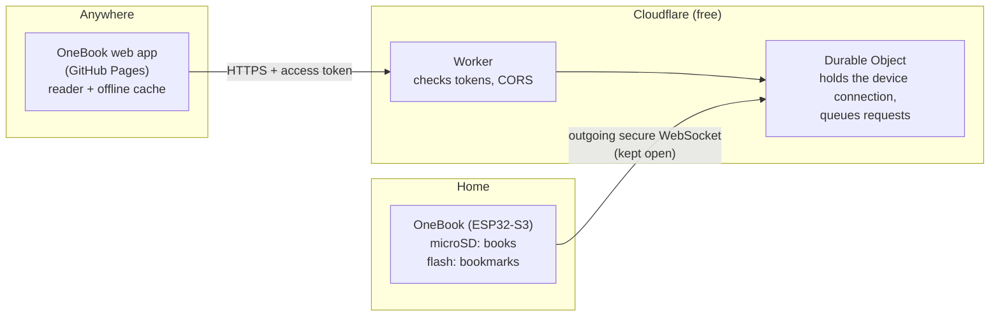

# OneBook

**A book-shaped server that holds your whole EPUB library.**

OneBook is a small ESP32-S3 board with a microSD card, built into a book-shaped case. It keeps your EPUB collection and your reading positions. You read in a web app on your phone or computer, from anywhere: at home, at work, or on the other side of the world, with no port forwarding and no monthly bill.

Web app: **https://makestreme.github.io/onebook/** ([source](https://github.com/makestreme/onebook))

---

## Features

**Your library**
- Hundreds of EPUBs on a microSD card. Book size is limited to 20 MB each.
- Library view with covers, titles, authors, search, and SD card usage.
- Upload books from the web app (drag and drop, several at once) or copy them onto the card from a computer.
- Delete books permanently from the web app.

**Reading**
- Fast and clean on both phones and desktops.
- Turn pages by tapping, swiping, using the arrow keys, or the side arrows on desktop.
- Table of contents, chapter, page and percentage display, and a progress bar.
- Light, Sepia and Dark themes, adjustable text size, a choice of fonts, and two-page view on wide screens.
- A book you open is downloaded once and kept in the browser, so page turns are instant and it can be read offline.
- Installs to your phone's home screen like an app.

**Bookmarks that follow you**
- Your last position is saved automatically. Open the book on another device and it picks up where you left off.
- Add as many named bookmarks as you like (up to 50 per book), then rename or delete them.
- When you reopen a book with bookmarks, OneBook asks where you'd like to start.
- Bookmarks are stored on OneBook itself, in its internal flash rather than on the SD card. Changes made on different devices, or while offline, merge cleanly.

**Built to be left on a shelf**
- One status LED, which stays off when everything is fine (see [LED meanings](#led-meanings)).
- Wi-Fi setup from your phone: if OneBook can't find its network, it opens a setup hotspot by itself. No buttons are needed.
- Reconnects on its own after power cuts, router restarts and Wi-Fi drops.
- A read-only status page on your home network at `http://onebook.local`.

**Private, secure and free**
- Runs on Cloudflare's free plan; there's nothing to pay.
- Encrypted end to end over HTTPS and a secure WebSocket (WSS). The device checks Cloudflare's certificate.
- Two separate secrets: one for the device, one for your reading apps.
- Generic: anyone can build their own OneBook and use the same web app with their own server address and token.

---

## How it works

1. **The device dials out.** When OneBook boots, it connects to your Wi-Fi and opens a secure WebSocket *out* to your Cloudflare Worker. Because the connection starts from inside your home, there's no port forwarding, no public IP, and nothing exposed on your router.
2. **The Worker is the front door.** The web app sends normal HTTPS requests, such as "list my books" or "download this book", to your Worker address. The Worker checks the access token and passes each request to a Durable Object. That's a single always-reachable Cloudflare instance that holds the device's WebSocket.
3. **Requests go down the tunnel.** The Durable Object turns each request into a small message, sends it down the WebSocket, and streams the device's answer back to the browser. The device serves one request at a time, so the Durable Object queues the rest.
4. **Reading happens in the browser.** The web app downloads the whole EPUB once, stores it in the browser (IndexedDB), and renders it locally with [epub.js](https://github.com/futurepress/epub.js). Turning pages never touches the network.
5. **Bookmarks sync back.** Your position and bookmarks are kept as a small JSON document per book. The web app merges its copy with OneBook's on open, on changes, every ~30 seconds while reading, and when you leave the page. OneBook stores it in its internal flash; the SD card is only written when you add or remove books.

### Where things are stored

| What | Where | Why |
|---|---|---|
| EPUB files | microSD `/books/` | Large, rarely written |
| Cover, title, author | microSD `/.onebook/meta/` | Created by the web app on upload |
| Bookmarks and last position | ESP32 internal flash (LittleFS) | Small, written often; keeps wear off the SD card |
| Downloaded books, settings | Your browser | Instant page turns, offline reading |

### Security model
- **Device secret**: only your OneBook can connect to your Worker.
- **Access token**: only apps with the token can use your library.
- **Allowed origin**: browsers only allow calls to your Worker from the web app's address.
- **Certificate check**: the device verifies it's really talking to Cloudflare. It carries the root certificates of every authority Cloudflare uses for free certificates.
- Secrets are stored as Cloudflare secrets, in OneBook's flash, and in your browser. They never appear in the code.

---

## LED meanings

| LED | Meaning |
|---|---|
| Off | Everything is fine and OneBook is idle |
| Blinking white | Connecting to Wi-Fi |
| Blue | Setup hotspot `OneBook-Setup` is open |
| Purple | Wi-Fi is fine, but there's no connection to your Cloudflare Worker |
| Amber | Sending or receiving a book |
| Green flash | A bookmark was added, renamed or deleted |
| Red | SD card problem (missing, unreadable, or not FAT32) |

---

## What's in this repository

| Folder | Contents |
|---|---|
| [OneBook/](OneBook/) | ESP32-S3 firmware: a single `OneBook.ino` file for the Arduino IDE |
| [worker/](worker/) | Cloudflare Worker and Durable Object (`worker.js`, `wrangler.toml`) |
| [SETUP.md](SETUP.md) | Step-by-step software setup guide |

The web app lives in its own repository, **[makestreme/onebook](https://github.com/makestreme/onebook)**, and is hosted at **https://makestreme.github.io/onebook/**. You don't need to host it yourself: everyone uses the same web app with their own Worker address and token.

---

## Build your own

There are two parts:

1. **Hardware:** parts, wiring and the book-shaped case are covered in the **[OneBook build guide on Instructables](INSTRUCTABLES-LINK)**.
2. **Software:** everything else is in **[SETUP.md](SETUP.md)**. It's written for beginners, with instructions for Windows, macOS and Linux:
   - preparing the SD card
   - creating your secrets
   - putting your tunnel on Cloudflare
   - installing the firmware with the Arduino IDE
   - first-boot Wi-Fi setup
   - connecting the web app
   - troubleshooting

You'll need:
- A built OneBook. It's based on an ESP32-S3 with 8 MB flash, a microSD card module, and an optional WS2812B LED.
- A free Cloudflare account.
- A computer (Windows, macOS or Linux) for the one-time setup.

---

## Limits worth knowing
- **EPUB only, DRM-free only.** Books bought with DRM can't be opened by any web reader.
- **20 MB per book.**
- **Transfer speed** is roughly 100-400 KB/s through the tunnel, so a typical 1-2 MB book takes a few seconds. After that it's stored in your browser.
- **One request at a time.** Several readers can use the same OneBook, but transfers queue behind each other.
- **Free plan headroom.** Cloudflare's free plan allows 100,000 requests per day, and a personal library uses a few hundred.

---

## Credits
- [epub.js](https://github.com/futurepress/epub.js) (BSD 2-Clause) and [JSZip](https://github.com/Stuk/jszip) (MIT): EPUB rendering in the web app.
- [WiFiManager](https://github.com/tzapu/WiFiManager), [arduinoWebSockets](https://github.com/Links2004/arduinoWebSockets), [ArduinoJson](https://arduinojson.org/): firmware libraries.
- [Cloudflare Workers and Durable Objects](https://developers.cloudflare.com/durable-objects/): the free tunnel.
